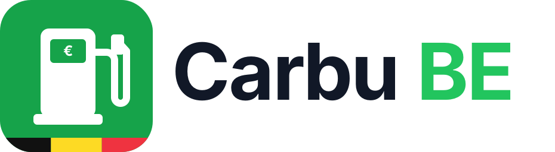

# Carbu BE — prix carburants Belgique pour Home Assistant

Auteur : Florent Appointaire

Intégration HACS qui récupère sur [carbu.com](https://carbu.com/belgique/) les prix des stations autour d'une commune belge et crée, pour chaque carburant choisi :

| Capteur | État | Attributs utiles |
|---|---|---|
| `sensor.carbu_<commune>_<carburant>_moins_cher` | prix le plus bas (€/L) | station, marque, adresse, url, date de mise à jour, `stations` (top 10) |
| `sensor.carbu_<commune>_<carburant>_station` | « Station – adresse (distance) » de la moins chère | latitude, longitude, maps_url, prix |
| `sensor.carbu_<commune>_<carburant>_moyenne` | prix moyen (€/L) | min, max, nombre de stations, économie sur 50 L |

Carburants : Super 95 (E10), Super 98 (E5), Diesel (B7), LPG.

> Non affilié à carbu.com. Les données sont lues sur le site public (scraping) : si carbu.com change sa page, l'intégration peut cesser de fonctionner.

## Installation

**Via HACS (dépôt personnalisé)**
1. Publie ce dossier dans un dépôt GitHub (public ou privé lié à HACS).
2. HACS → menu ⋮ → *Dépôts personnalisés* → URL du dépôt, type **Intégration**.
3. Installe « Carbu BE », puis redémarre Home Assistant.

**Manuelle**
Copie `custom_components/carbu_be` dans `/config/custom_components/`, puis redémarre.

## Configuration

Paramètres → Appareils et services → Ajouter une intégration → **Carbu BE**
1. Code postal (ex. `1480`)
2. Commune (ex. Tubize) et carburants

Options (bouton *Configurer*) : carburants, intervalle de rafraîchissement (60 min par défaut, 30 min minimum) et **distance maximale** autour de la commune (10 km par défaut).

## Localisation de la station

Le capteur « moins cher » expose `latitude`, `longitude`, `distance_km`, `full_address` et `maps_url` (lien Google Maps). La liste `stations` (top 10) contient aussi les coordonnées de chaque station.

Carte avec la station la moins chère :

```yaml
type: map
title: Carburant le moins cher
entities:
  - entity: sensor.carbu_tubize_1480_diesel_b7_moins_cher
  - entity: sensor.carbu_tubize_1480_super_95_e10_moins_cher
```

Lien cliquable vers Google Maps :

```yaml
type: markdown
content: >
  
  **{{ state_attr(s,'station') }}** – {{ states(s) }} €/L
  ({{ state_attr(s,'distance_km') }} km)<br>
  [{{ state_attr(s,'full_address') }}]({{ state_attr(s,'maps_url') }})
```

## Plusieurs communes

Paramètres → Appareils et services → Carbu BE → **Ajouter une entrée**, puis un autre code postal. Chaque commune devient un appareil séparé avec ses propres capteurs.

## Exemple d'automatisation

```yaml
alias: Alerte diesel pas cher
triggers:
  - trigger: numeric_state
    entity_id: sensor.carbu_tubize_1480_diesel_b7_moins_cher
    below: 1.75
actions:
  - action: notify.notify
    data:
      message: >
        Diesel à {{ states('sensor.carbu_tubize_1480_diesel_b7_moins_cher') }} €/L
        chez {{ state_attr('sensor.carbu_tubize_1480_diesel_b7_moins_cher', 'station') }}
```

Les noms exacts des entités sont visibles dans l'appareil « Carbu Tubize (1480) ».

## Dépannage

```yaml
logger:
  logs:
    custom_components.carbu_be: debug
```

Un message « No station/price found … layout may have changed » signifie que la page carbu.com a changé : ouvre une issue avec l'URL indiquée dans le log.
